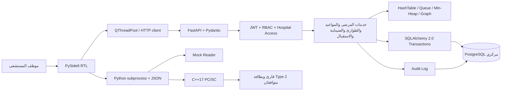

# معمارية MediLink NFC

## حدود المسؤولية

- Python هو تطبيق الأعمال وهياكل البيانات. C++ خاص بالقارئ فقط. لا SQL في Desktop ولا بيانات طبية على البطاقة.
- خادم مركزي وقاعدة واحدة، مع hospital_id وقيود الوصول؛ ليس نظاماً موزعاً.
- جميع الأوقات الطبية/الإدارية في الخادم UTC-aware. الرسائل موجهة للمستخدم بالعربية. أسماء حقول API بالإنكليزية لسهولة التكامل.
- قاعدة البيانات هي المصدر الرسمي. الهياكل تعاد من الصفوف وتبقى صحيحة بعد إعادة التشغيل ومع تعدد عمليات API.

## الوصول

JWT يحمل هوية الموظف وانتهاء الصلاحية فقط؛ الخادم يعيد قراءة active والأدوار والمستشفى في كل طلب. تغيير دور الموظف أو تعطيله يسري على الرموز الحالية.

الدور admin للإدارة وليس دوراً طبياً شاملاً. الطبيب وحده يرى الزيارات والتشخيصات ويكتب الوصفات. الممرض يرى الحساسية والأمراض المزمنة والطوارئ. الصيدلي يرى الوصفات المسموح بها دون ملاحظات الزيارة. الاستقبال يرى البيانات التعريفية والمواعيد والفواتير. يمكن منح أكثر من دور لحساب بواسطة المدير.

وصول ملف المريض يتطلب patient_hospital_access.active للمستشفى الحالي. مشاهدة سجل طبي من مستشفى آخر تتطلب أيضاً shared على ذلك السجل. grant لا يحول السجلات الخاصة إلى عامة. الزيارات والفواتير والطوابير لا تقبل hospital_id من عميل غير موثوق؛ يستنتجه الخادم من الموظف.

الإحالة تقبل في الوجهة بواسطة طبيب، وبعدها تنشئ منحة الوصول. Graph لا يشارك الملفات. جميع القراءات العابرة للمستشفيات تُسجّل مع المصدر ورقم السجل. لا تحوي سجلات التدقيق نص التشخيص أو رمز NFC.

## التزامن والمعاملات

- Session لكل طلب مع commit قبل إرسال الاستجابة، وrollback موحد عند الخطأ.
- حجز الطبيب والمريض يستخدم PostgreSQL EXCLUDE USING gist على tstzrange، بحدود نصف مفتوحة [start,end)، ويستثني الحالة الملغاة. يسمح بموعدين متجاورين ويمنع التقاطع ولو بين طلبين متزامنين.
- إصدار/استبدال بطاقة يقفل صف المريض ويستند إلى unique partial index لبطاقة فعالة واحدة.
- الدفع يقفل صف الفاتورة، ثم يحسب الرصيد ويرفض الزيادة، ويسجل request_key فريداً لإعادة المحاولة الآمنة. لا تستخدم float للأموال.
- صرف الوصفة يقفل صفها ويرفض صرفها مرتين. التصحيح الإداري يحتاج سبباً وسجل تدقيق.
- أخذ الدور أو الحالة التالية يستخدم advisory transaction lock منفصلاً لكل مستشفى ووحدة، ثم يعيد بناء البنية من البيانات الملتزم بها.

## حدود النموذج التعليمي

ليس جهازاً طبياً أو نظاماً معتمداً. لا تنبؤ ولا اتخاذ قرار طبي آلي. بطاقات Type 2 قابلة للاستنساخ؛ الرمز وسيلة بحث بعد مصادقة الموظف، وليس إثبات هوية المريض أو كلمة مرور. تشغيل HTTP مقصور افتراضياً على localhost. نشره عبر شبكة فعلية يحتاج TLS، مراقبة دخول، سياسة احتفاظ، نسخ احتياطي، إدارة أسرار ومراجعة أمن مستقلة.
