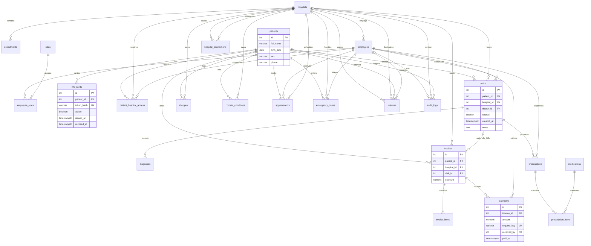

# قاعدة البيانات

PostgreSQL حصراً، SQLAlchemy 2.0 وAlembic. المريض صف موحد؛ لا يُكرر لكل مستشفى. العملات التجريبية بالدينار العراقي مع دقة منزلتين؛ جميع المبالغ NUMERIC(12,2). المجموع والرصيد مشتقان من البنود والمدفوعات، وليسا حقولاً مكررة قابلة للانحراف.

## التطبيع والقيود

الموظف له مستشفى واحد وأدوار متعددة عبر employee_roles. الزيارة تحمل الطبيب والمستشفى، والتشخيصات في جدول مستقل. الوصفة مرتبطة بزيارة، وبنودها بالأدوية المرجعية؛ لا مخزون أو مورّدون. سجلات الحساسية والأمراض لها مصدر وقرار مشاركة مستقلان. hospital_connections حواف موجهة بمفتاح مركب. الإحالة لا تكرر مسار الرسم؛ يحسب المسار الحالي عند العرض، وتُحفظ نسخة الطريق عند الإنشاء في سجل التدقيق.

مفاتيح أجنبية تمنع المراجع المفقودة. Unique لاسم المستشفى/المستخدم/الدواء/الدور، وhash البطاقة ومفتاح الدفع. Check للنطاقات المالية وحالات الوصفة والموعد والطوارئ ومستويات الأولوية، واتساق بيانات الصرف. فهارس patient_id وhospital_id ومفاتيح الترتيب والبحث. يمنع partial unique index وجود بطاقتين فعالتين للمريض. EXCLUDE يمنع تقاطع المواعيد للطبيب أو للمريض في المستشفيات كافة.

السياسة المحافظة للحذف هي عدم إتاحة حذف السجلات الطبية من API؛ تستخدم حالات إلغاء/تعطيل. لا تزال بيانات العرض فقط، والسياسات القانونية الفعلية خارج النطاق.

## Migration والبيانات التجريبية

`python -m alembic upgrade head` لإنشاء الجداول والقيود. Migration أولية ثابتة؛ لا تستدعي metadata.create_all وقت التشغيل. يحتاج حساب الترحيل صلاحية إنشاء extension btree_gist. `python -m scripts.seed` ينشئ مستشفيين و10 موظفين وثلاثة مرضى وأدوية تعليمية وروابط الإحالة. تُقرأ كلمة المرور من DEMO_PASSWORD ولا تُكتب في المصدر.

اختبارات التكامل ترفض أي اسم قاعدة لا ينتهي بـ `_test`. إعادة بناء بيانات الاختبار لا تمس `medilink`. بيانات البيئة المحلية الفعلية تحت `.runtime` ومستبعدة من Git.
